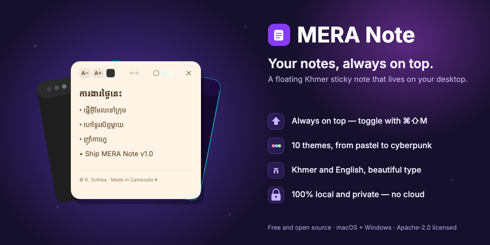

# MERA Note



A lightweight, always-on-top **Khmer-language desktop sticky note**. It floats above your other windows, stays one keystroke away, and keeps everything on your machine — no account, no cloud, no tracking.

Built with Electron, React, and Vite.

## Features

- **Always on top** — a frameless, transparent note that floats over everything and follows you across workspaces and fullscreen apps.
- **One-keystroke show/hide** — toggle the note with <kbd>Cmd/Ctrl</kbd> + <kbd>Shift</kbd> + <kbd>M</kbd>.
- **10 themes** — pastel yellow / blue / green / pink, a Khmer frame, plus dark, cyberpunk, dark blue, dark grey, and dark green.
- **Khmer + English** — the [Suwannaphum](https://github.com/danhhong/Suwannaphum) font is bundled, so Khmer renders beautifully out of the box.
- **Make it yours** — adjustable font size (10–72 px) and a custom text-color picker.
- **Drag anywhere** — grab the note body to move it; the <kbd>✕</kbd> hides it to the background (the app keeps running — bring it back with the shortcut).
- **100% local & private** — notes are auto-saved to disk; the app makes **no network requests** at runtime.
- **Cross-platform** — packaged for macOS (`.dmg`) and Windows (`.exe`).

## Tech stack

- [Electron](https://www.electronjs.org/) 42 (desktop shell)
- [React](https://react.dev/) 19 + [Vite](https://vite.dev/) (renderer)
- [electron-builder](https://www.electron.build/) (packaging)
- [oxlint](https://oxc.rs/) (linting)

## Getting started

Requires Node.js 20+.

```bash
# install dependencies
npm install

# run in development (Vite dev server + Electron with hot reload)
npm run dev

# lint
npm run lint
```

## Building installers

```bash
# builds the renderer, then packages macOS (.dmg) and Windows (.exe) into release/
npm run build
```

> **Note on unsigned builds:** the installers are **not code-signed or notarized**. On first launch, macOS Gatekeeper and Windows SmartScreen will warn that the app is from an unidentified developer. To sign them, add your Apple Developer ID / Windows certificate to the `electron-builder` config. Packaged output lands in `release/` (which is git-ignored — distribute it via GitHub Releases, not source control).

## Where your notes live

Notes and window state are stored as a single JSON file in Electron's per-user data directory:

- **macOS:** `~/Library/Application Support/MERA Note/mera_note_store.json`
- **Windows:** `%APPDATA%\MERA Note\mera_note_store.json`

Your note content never leaves your computer.

## Security

MERA Note follows Electron's security best practices:

- `contextIsolation` on, `nodeIntegration` off, renderer sandboxed
- a strict Content-Security-Policy and a navigation/window-open lockdown
- IPC handlers validate their sender and sanitize payloads
- no remote resources — the font is self-hosted and bundled

## License

Licensed under the [Apache License 2.0](LICENSE) — see [`LICENSE`](LICENSE) and [`NOTICE`](NOTICE).

### Font attribution

This app bundles the **Suwannaphum** font, Copyright 2019 The Suwannaphum Project Authors ([github.com/danhhong/Suwannaphum](https://github.com/danhhong/Suwannaphum)), licensed under the [SIL Open Font License, Version 1.1](licenses/Suwannaphum-OFL.txt). The font is embedded unmodified.

---

© K. Sothea · Made in Cambodia ♥
